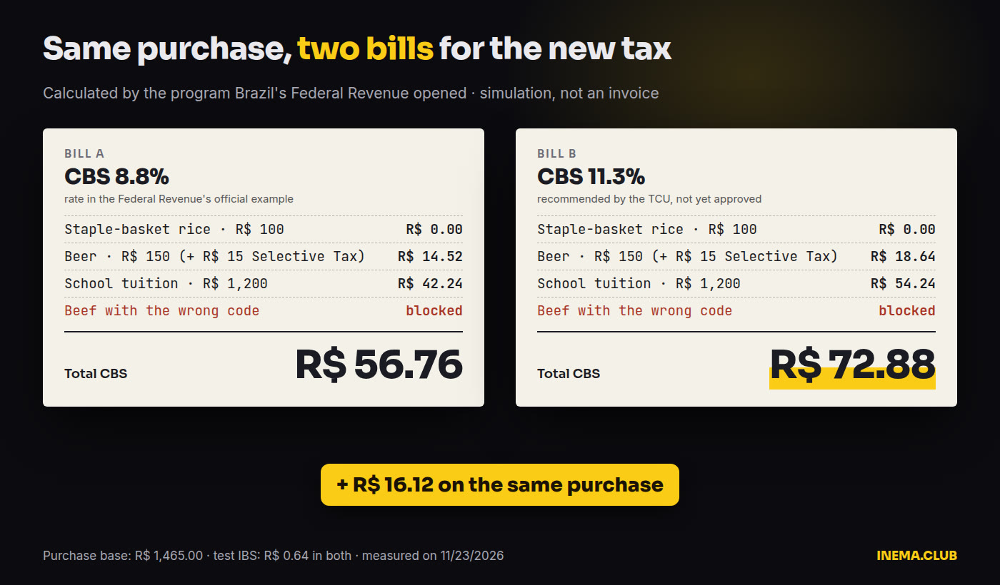
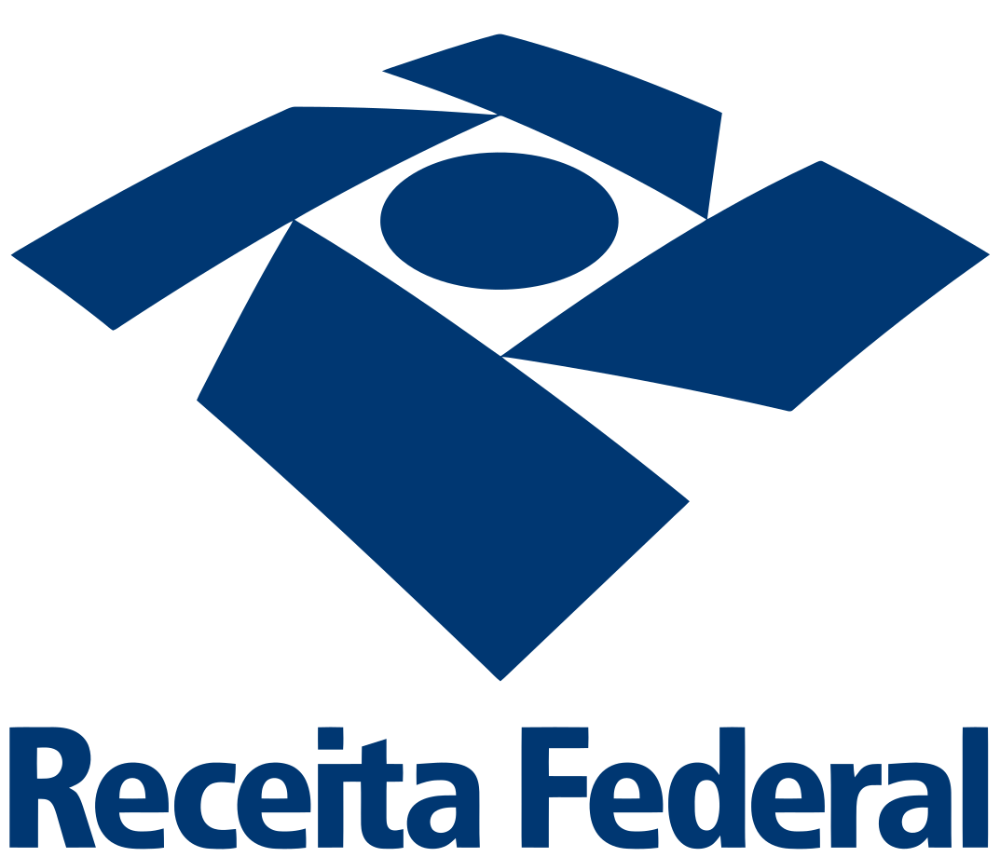

# The Receita Opened the Calculation

**🇧🇷 [Português](README.md) · 🇺🇸 [English](README.en.md) · 🇪🇸 [Español](README.es.md)**

[](https://inematds.github.io/receita-abriu-o-calculo/guia/en/)

## What it is

A free, unofficial INEMA explainer about what happened in November 2026: the Receita Federal opened to everyone the program that calculates the new taxes under the tax reform (CBS, IBS, and the Selective Tax). The page shows the same purchase calculated in that program using the two rates under discussion (8.8% from the official example and 11.3% recommended by the TCU, not yet approved), tells the November timeline, and explains what changes for people who buy, sell, do accounting, or build software. Just read it.

## 📖 Page

**https://inematds.github.io/receita-abriu-o-calculo/guia/en/** (also in [English](https://inematds.github.io/receita-abriu-o-calculo/guia/en/) and [Spanish](https://inematds.github.io/receita-abriu-o-calculo/guia/es/))

Want to run the calculation with your own sales? The **Calculadora aberta** kit runs the Receita Federal program on your computer: **https://inematds.github.io/calculadora-da-reforma/guia/en/**. Without installing anything, the Receita Federal also offers an [online calculator](https://piloto-cbs.tributos.gov.br/servico/calculadora-consumo/calculadora) (in Portuguese).

## Source

<a href="https://www.gov.br/receitafederal/pt-br/assuntos/noticias/2026/novembro/receita-federal-publica-primeiro-codigo-fonte-aberto-no-github-e-amplia-transparencia-da-reforma-tributaria"></a>

The logo indicates where the news and code come from ([Receita Federal announcement, 16/11/2026](https://www.gov.br/receitafederal/pt-br/assuntos/noticias/2026/novembro/receita-federal-publica-primeiro-codigo-fonte-aberto-no-github-e-amplia-transparencia-da-reforma-tributaria) (in Portuguese); [Cotec Ordinance No. 342](https://www.in.gov.br/web/dou/-/portaria-cotec-n-342-de-12-de-novembro-de-2026-744398356) (in Portuguese)). This explainer is by INEMA, not the Receita Federal; it has not been reviewed or endorsed by them. Logo: public-domain file from [Wikimedia Commons](https://commons.wikimedia.org/wiki/File:Logo_Receita_Federal_do_Brasil.svg).

The figures in both calculations come from measurements made with the Calculadora aberta kit, run on 23/11/2026 using version 1.7.2 of the Receita Federal program: [MEDICOES.md](https://github.com/inematds/calculadora-da-reforma/blob/main/kit/MEDICOES.md).

---

## The process, from start to finish

| # | Step | Who | Command |
|---|---|---|---|
| 1 | Measure both calculations in the Receita Federal program | ⚙️ calculadora-da-reforma kit | `teste_do_motor.py` (see its README) |
| 2 | Write the PT page with the measured figures and sources | 🧠 session with Nei | edit `guia/index.html` |
| 3 | Generate the image of both calculations in all 3 languages | ⚙️ script | see “Technical setup” |
| 4 | Translate the page into EN and ES | 🤖 `inema-traduz` | `inema-traduz -o en.html < pedido.txt` |
| 5 | Independent reviewer | 🤖 new agent | runbook `revisor-independente.md` |
| 6 | Publish (GitHub Pages via Actions) | ⚙️ push | `git push` |
| 7 | Portal and INEMA.VIBE | 🧠 skills `atualiza-portal` and `postar-telegram` | — |

## Technical setup

There is no software to install: this is a static page (`guia/index.html`, `guia/en/`, `guia/es/`).

The image of both calculations is produced from `kit/notas.html`, with the figures entered by hand from MEDICOES.md (nothing is generated by AI, to avoid digit errors):

```bash
C=chromium   # or the path to Chrome/Chromium
for l in pt en es; do
  s=""; [ $l != pt ] && s="-$l"
  $C --headless --hide-scrollbars --virtual-time-budget=4000 \
     --screenshot=/tmp/notas-$l.png --window-size=1400,820 "file://$PWD/kit/notas.html?lang=$l"
  ffmpeg -y -i /tmp/notas-$l.png -q:v 3 guia/assets/notas$s.jpg
done
```

License: MIT for INEMA’s text and code. The Receita Federal logo is in the public domain and appears only as a source.