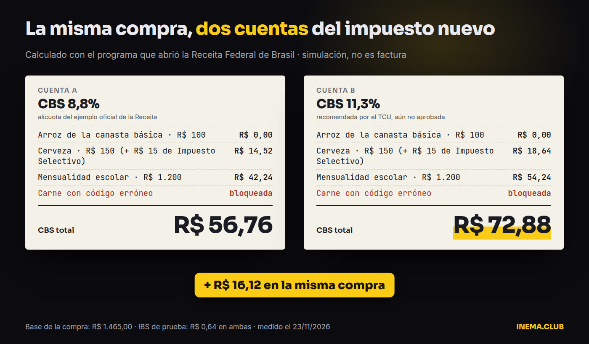
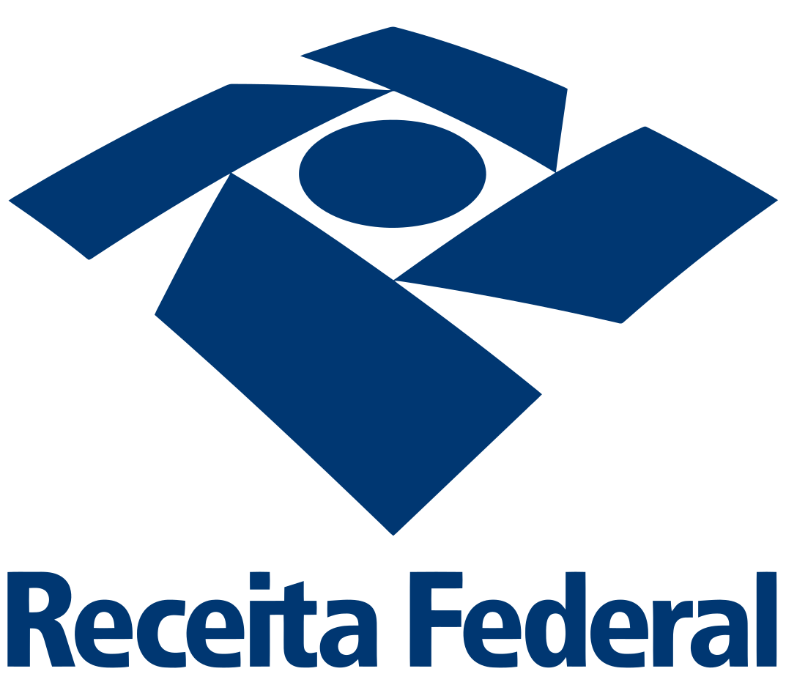

# Receita abriu o cálculo

**🇧🇷 [Português](README.md) · 🇺🇸 [English](README.en.md) · 🇪🇸 [Español](README.es.md)**

[](https://inematds.github.io/receita-abriu-o-calculo/guia/es/)

## Qué es

Un explicativo gratuito y no oficial de INEMA sobre lo que ocurrió en noviembre de 2026: la Receita Federal abrió para todo el mundo el programa que calcula los nuevos impuestos de la reforma tributaria (CBS, IBS e Impuesto Selectivo). La página muestra la misma compra calculada en ese programa con las dos alícuotas que están sobre la mesa (8,8% del ejemplo oficial y 11,3% recomendada por el TCU, aún no aprobada), cuenta la cronología de noviembre y explica qué cambia para quienes compran, venden, llevan la contabilidad o desarrollan sistemas. Solo hay que leer.

## 📖 Página

**https://inematds.github.io/receita-abriu-o-calculo/guia/es/** (también en [inglés](https://inematds.github.io/receita-abriu-o-calculo/guia/en/) y [español](https://inematds.github.io/receita-abriu-o-calculo/guia/es/))

¿Quieres hacer los cálculos con tus ventas? El kit **Calculadora aberta** pone en marcha en tu computadora el programa de la Receita: **https://inematds.github.io/calculadora-da-reforma/guia/es/**. Sin instalar nada, la Receita también tiene la [calculadora en línea](https://piloto-cbs.tributos.gov.br/servico/calculadora-consumo/calculadora) (en portugués).

## Fuente

<a href="https://www.gov.br/receitafederal/pt-br/assuntos/noticias/2026/novembro/receita-federal-publica-primeiro-codigo-fonte-aberto-no-github-e-amplia-transparencia-da-reforma-tributaria"></a>

El logotipo indica de dónde provienen la noticia y el código ([anuncio de la Receita, 16/11/2026](https://www.gov.br/receitafederal/pt-br/assuntos/noticias/2026/novembro/receita-federal-publica-primeiro-codigo-fonte-aberto-no-github-e-amplia-transparencia-da-reforma-tributaria) (en portugués); [Ordenanza Cotec n.º 342](https://www.in.gov.br/web/dou/-/portaria-cotec-n-342-de-12-de-novembro-de-2026-744398356) (en portugués)). Este explicativo es de INEMA, no de la Receita, y la institución no lo ha revisado ni avalado. Logotipo: archivo de dominio público de [Wikimedia Commons](https://commons.wikimedia.org/wiki/File:Logo_Receita_Federal_do_Brasil.svg).

Las cifras de los dos cálculos provienen de las mediciones del kit Calculadora aberta, realizadas el 23/11/2026 con la versión 1.7.2 del programa de la Receita: [MEDICOES.md](https://github.com/inematds/calculadora-da-reforma/blob/main/kit/MEDICOES.md).

---

## El proceso, de principio a fin

| # | Paso | Quién | Comando |
|---|---|---|---|
| 1 | Medir los dos cálculos en el programa de la Receita | ⚙️ kit calculadora-da-reforma | `teste_do_motor.py` (ver el README de allí) |
| 2 | Escribir la página PT con las cifras medidas y las fuentes | 🧠 sesión con Nei | edita `guia/index.html` |
| 3 | Generar la imagen de los dos cálculos en los 3 idiomas | ⚙️ script | ver «Instalación técnica» |
| 4 | Traducir la página a EN y ES | 🤖 `inema-traduz` | `inema-traduz -o en.html < pedido.txt` |
| 5 | Revisor independiente | 🤖 agente nuevo | runbook `revisor-independente.md` |
| 6 | Publicar (GitHub Pages mediante Actions) | ⚙️ push | `git push` |
| 7 | Portal e INEMA.VIBE | 🧠 skills `atualiza-portal` y `postar-telegram` | — |

## Instalación técnica

No hay ningún programa que instalar: es una página estática (`guia/index.html`, `guia/en/`, `guia/es/`).

La imagen de los dos cálculos se genera a partir de `kit/notas.html`, con las cifras escritas a mano tomando como referencia MEDICOES.md (no se genera nada con IA, para evitar errores en los dígitos):

```bash
C=chromium   # ou o caminho do Chrome/Chromium
for l in pt en es; do
  s=""; [ $l != pt ] && s="-$l"
  $C --headless --hide-scrollbars --virtual-time-budget=4000 \
     --screenshot=/tmp/notas-$l.png --window-size=1400,820 "file://$PWD/kit/notas.html?lang=$l"
  ffmpeg -y -i /tmp/notas-$l.png -q:v 3 guia/assets/notas$s.jpg
done
```

Licencia: MIT para el texto y el código de INEMA. El logotipo es de la Receita Federal (dominio público) y aparece solo como fuente.