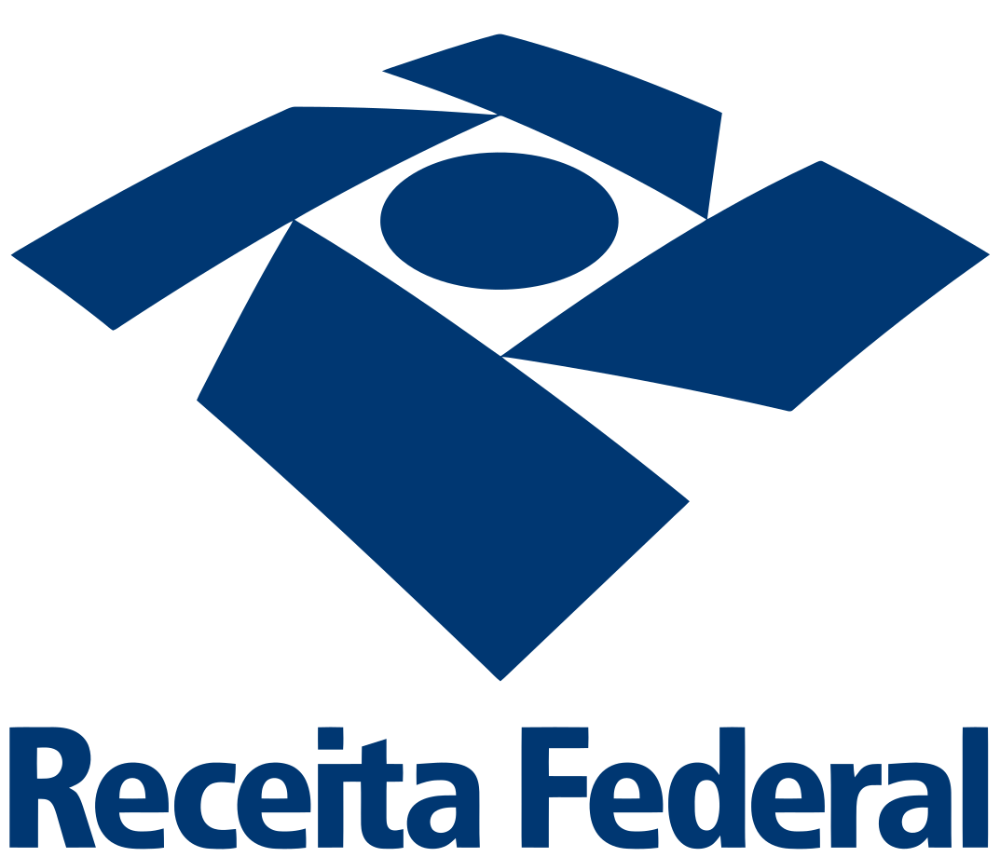

# Receita abriu o cálculo

**🇧🇷 [Português](README.md) · 🇺🇸 [English](README.en.md) · 🇪🇸 [Español](README.es.md)**

[](https://inematds.github.io/receita-abriu-o-calculo/guia/)

## O que é

Um explicativo grátis e não oficial do INEMA sobre o que aconteceu em novembro de 2026: a Receita Federal abriu para todo mundo o programa que calcula os impostos novos da reforma tributária (CBS, IBS e Imposto Seletivo). A página mostra a mesma compra calculada nesse programa com as duas alíquotas que estão na mesa (8,8% do exemplo oficial e 11,3% recomendada pelo TCU, ainda não aprovada), conta a linha do tempo de novembro e diz o que muda para quem compra, vende, faz contabilidade ou faz sistema. É só ler.

## 📖 Página

**https://inematds.github.io/receita-abriu-o-calculo/guia/** (também em [inglês](https://inematds.github.io/receita-abriu-o-calculo/guia/en/) e [espanhol](https://inematds.github.io/receita-abriu-o-calculo/guia/es/))

Quer rodar a conta com as suas vendas? O kit **Calculadora aberta** põe o programa da Receita para funcionar no seu computador: **https://inematds.github.io/calculadora-da-reforma/guia/**. Sem instalar nada, a Receita também tem a [calculadora online](https://piloto-cbs.tributos.gov.br/servico/calculadora-consumo/calculadora).

## Fonte

<a href="https://www.gov.br/receitafederal/pt-br/assuntos/noticias/2026/novembro/receita-federal-publica-primeiro-codigo-fonte-aberto-no-github-e-amplia-transparencia-da-reforma-tributaria"></a>

O logotipo indica de onde vem a notícia e o código ([anúncio da Receita, 16/11/2026](https://www.gov.br/receitafederal/pt-br/assuntos/noticias/2026/novembro/receita-federal-publica-primeiro-codigo-fonte-aberto-no-github-e-amplia-transparencia-da-reforma-tributaria); [Portaria Cotec nº 342](https://www.in.gov.br/web/dou/-/portaria-cotec-n-342-de-12-de-novembro-de-2026-744398356)). Este explicativo é do INEMA, não da Receita, e ela não o revisou nem o endossa. Logotipo: arquivo de domínio público do [Wikimedia Commons](https://commons.wikimedia.org/wiki/File:Logo_Receita_Federal_do_Brasil.svg).

Os números das duas contas vêm das medições do kit Calculadora aberta, rodadas em 23/11/2026 com a versão 1.7.2 do programa da Receita: [MEDICOES.md](https://github.com/inematds/calculadora-da-reforma/blob/main/kit/MEDICOES.md).

---

## O processo, do início ao fim

| # | Passo | Quem | Comando |
|---|---|---|---|
| 1 | Medir as duas contas no programa da Receita | ⚙️ kit calculadora-da-reforma | `teste_do_motor.py` (ver o README de lá) |
| 2 | Escrever a página PT com os números medidos e as fontes | 🧠 sessão com o Nei | edita `guia/index.html` |
| 3 | Gerar a imagem das duas contas nos 3 idiomas | ⚙️ script | ver "Instalação técnica" |
| 4 | Traduzir a página para EN e ES | 🤖 `inema-traduz` | `inema-traduz -o en.html < pedido.txt` |
| 5 | Revisor independente | 🤖 agente novo | runbook `revisor-independente.md` |
| 6 | Publicar (GitHub Pages por Actions) | ⚙️ push | `git push` |
| 7 | Portal e INEMA.VIBE | 🧠 skills `atualiza-portal` e `postar-telegram` | — |

## Instalação técnica

Não há programa para instalar: é uma página estática (`guia/index.html`, `guia/en/`, `guia/es/`).

A imagem das duas contas sai de `kit/notas.html`, com os números escritos à mão a partir do MEDICOES.md (nada é gerado por IA, para não errar dígito):

```bash
C=chromium   # ou o caminho do Chrome/Chromium
for l in pt en es; do
  s=""; [ $l != pt ] && s="-$l"
  $C --headless --hide-scrollbars --virtual-time-budget=4000 \
     --screenshot=/tmp/notas-$l.png --window-size=1400,820 "file://$PWD/kit/notas.html?lang=$l"
  ffmpeg -y -i /tmp/notas-$l.png -q:v 3 guia/assets/notas$s.jpg
done
```

Licença: MIT para o texto e o código do INEMA. O logotipo é da Receita Federal (domínio público) e aparece só como fonte.
